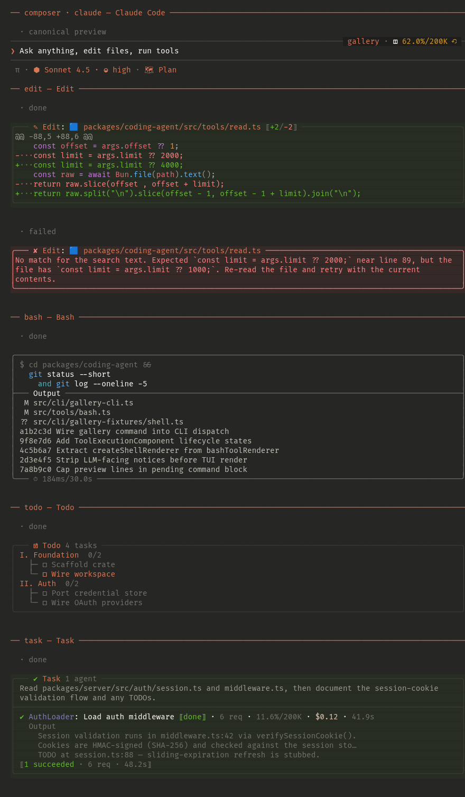
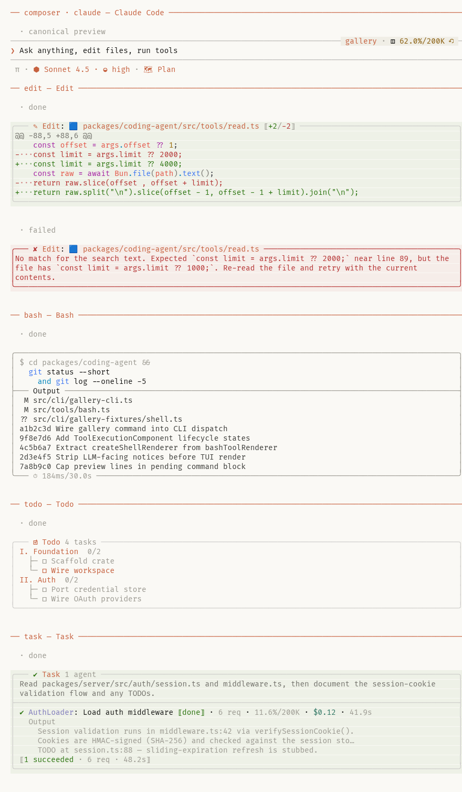

# omp — Claude desktop themes

Dark and light [oh-my-pi](https://github.com/can1357/oh-my-pi) themes that follow the Claude desktop
app (claude.ai's chat UI): warm off-black or ivory surfaces, ivory/ink text, clay accents, blue
links, red-tinted inline code, and One Dark / One Light code.

| Dark | Light |
|---|---|
|  |  |

## Install

```sh
./install.sh          # copy both themes into ~/.omp/agent/themes
./install.sh --use    # copy, then set them as omp's dark and light themes
```

Or pick **claude-desktop-dark** / **claude-desktop-light** in omp's `/settings` → Appearance.
omp picks the dark or light one from the terminal's background. `./install.sh --uninstall`
removes the files; `PI_CODING_AGENT_DIR` targets another agent dir.

### Closest to the desktop app: `--preset`

The themes set colors only; the rest of the look comes from omp settings. `presets/claude-desktop.yml`
holds the ones that differ from Claude desktop. It is opt-in: nothing else in this repo applies it.

```sh
./install.sh --preset --dry-run   # show each key's current and new value, write nothing
./install.sh --preset             # write the changed keys with `omp config set`
omp --config presets/claude-desktop.yml   # or try it for one run
```

| Setting | omp default | Preset | Why |
|---|---|---|---|
| `tui.colorfulMarkdown` | `true` | `false` | Claude keeps headings and bold in the text color and inline code red; the colorful mode paints them from the terminal's ANSI colors |
| `tui.reactions` | `true` | `false` | no emoji reactions on your messages |
| `tui.hyperlinks` | `auto` | `always` | every link is clickable (Herdr renders OSC 8 links) |
| `composer.shape` | `band` | `box` | a rounded card around the prompt, status in its top border |
| `statusLine.preset` | `default` | `custom` | only the model picker sits next to Claude's composer |
| `statusLine.leftSegments` | `vim`, `model`, `mode`, `path`, `git`, `pr` | `model`, `mode`, `status` | `mode` keeps plan/bash modes visible, `status` keeps extension statuses; Herdr's pane header already shows folder and branch |
| `statusLine.rightSegments` | `session_name`, `token_total`, `cost`, `context_pct` | `context_pct` | context use only |
| `statusLine.separator` | `powerline-thin` | `none` | no powerline arrows |
| `statusLine.sessionAccent` | `true` | `false` | the composer border is never tinted per session |
| `statusLine.contextLine` | `embedded` | `off` | no context meter drawn into the composer border; the `context_pct` segment shows the percentage instead |
| `display.shimmer` | `classic` | `disabled` | the spark spinner is the working indicator, no text shimmer |
| `read.renderMarkdown` | `false` | `true` | Markdown documents show rendered |
| `terminal.programStatus` | `true` | `true` | kept on: Herdr's agent status dots read it (OSC 7501) |

Keys already at the preset value are left alone. Undo one with `omp config reset <key>`, which
removes it from `config.yml` so omp's default applies again.

The preset picks `box` because it only outlines the composer. The filled shapes (`field`, `rail`)
paint it with the theme's `userMessageBg`, which here is the user bubble color (`--bg-300`), not
Claude's composer card (`--bg-000`). The themes keep the bubble right instead.

The themes' `terminal` section is the terminal they were made for (`#262624` / `#faf9f5`
background). The same palette ships for the Herdr app in
[herdr-claude-theme](https://github.com/Tim-van-Oudheusden/herdr-claude-theme).

## Where the colors come from

| omp tokens | Claude desktop source |
|---|---|
| terminal background, `userMessageBg`, `toolPendingBg`, `statusLineBg` | `--bg-100`, `--bg-300` (user bubble), `--bg-000` (cards), `--bg-200` (sidebar) |
| `text`, `toolOutput`, `muted`, `dim` | `--text-100`, `--text-200`, `--text-400`, `--text-500` |
| `border`, `borderAccent`, `thinking*` | the border gray; the composer border (thinking level) and context meter (`borderAccent`) stay neutral like Claude's |
| `accent`, `statusLineModel`, `mdExtensionLink` | `--accent-brand` clay `#d97757` (light: `--brand-000` `#c6613f`) |
| `mdLink`, `statusLineContext` | `--accent-000` blue |
| `mdCode` | `--danger-000`, the color of claude.ai's inline code |
| `success`, `error`, `warning`, diffs | `--success-*`, `--danger-*`, `--warning-*` |
| `customMessageLabel`, `subagent6` | `--accent-pro-*` violet |
| `syntax*`, `mdCodeBlock` | One Dark (dark); One Light (light, since omp can't paint the code block's background) |
| `subagent1`–`5` | Anthropic's plum, mineral, peach and cactus, plus blue/amber/green in light |

Tool result tints mix the success/danger colors 6–9% into the background. The spinner uses
the Claude spark glyphs.

## Previews

`scripts/preview.py` regenerates `docs/preview-*.png` from `omp gallery` in a throwaway agent dir,
so it reads none of your settings. It needs `omp` and Chromium (on `PATH` or the
`org.chromium.Chromium` flatpak).
